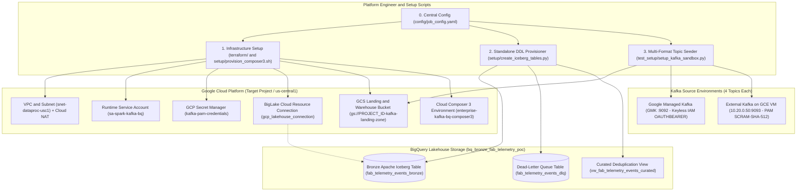
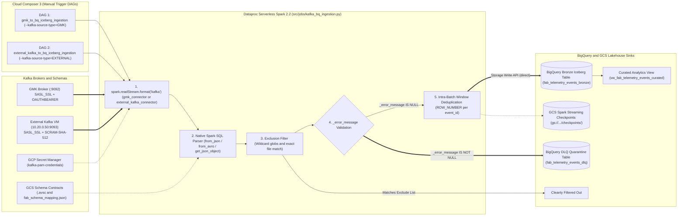
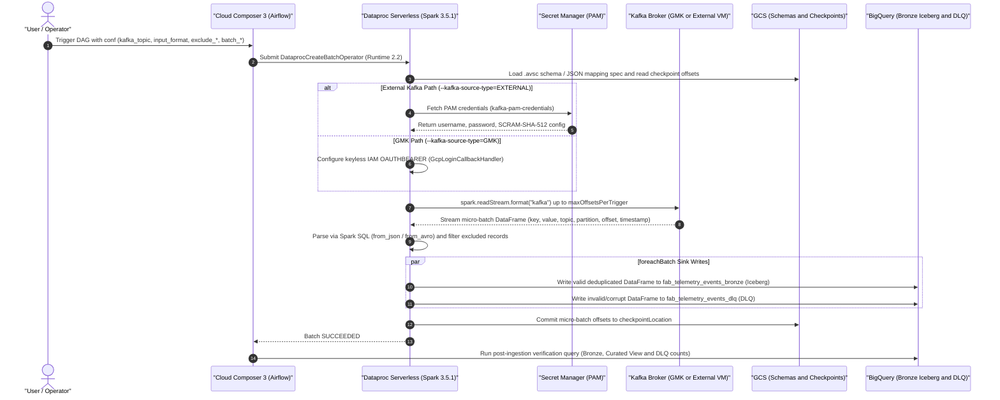
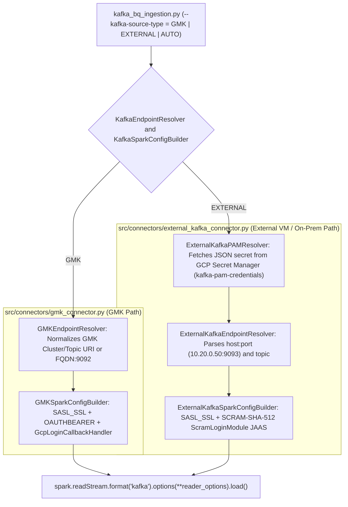

# Enterprise Apache Kafka to BigQuery Apache Iceberg Ingestion Framework (PySpark on Dataproc Serverless)

Production-grade, parameterized **PySpark Structured Streaming** ingestion template built for **Google Cloud Dataproc Serverless (`2.2` / Apache Spark `3.5.1`)**, **Google Cloud Managed Service for Apache Kafka (GMK)**, **External Apache Kafka on GCE VM / On-Premises (via PAM & GCP Secret Manager)**, **Google Cloud Storage (GCS)**, and **BigQuery-Managed Apache Iceberg Bronze Tables** with automated **Dead-Letter Queue (DLQ)** quarantine, orchestrated via **Cloud Composer 3 (Apache Airflow)**.

---

## Environment & Central Configuration Summary (`config/job_config.yaml`)

Project-specific identifiers are **never hardcoded in the source code**. All scripts, connectors, and Cloud Composer 3 DAGs dynamically load their environment defaults from [`config/job_config.yaml`](config/job_config.yaml) (and can be overridden at runtime via CLI flags, environment variables, or Airflow DAG Run JSON configuration):

| Resource / Component | Config Key in `config/job_config.yaml` | Default Pattern / Value | Description |
| :--- | :--- | :--- | :--- |
| **GCP Project ID** | `project_id` | `<YOUR_GCP_PROJECT_ID>` | Target Google Cloud project hosting compute, storage, Kafka, and BigQuery |
| **GCP Region** | `region` | `us-central1` | Region for Dataproc Serverless, GMK, GCE VM, GCS, and BigQuery |
| **GMK Bootstrap Server** | `gmk_bootstrap_servers` | `bootstrap.sample-kafka-target-cluster.us-central1.managedkafka.<YOUR_GCP_PROJECT_ID>.cloud.goog:9092` | Google Cloud Managed Service for Apache Kafka (`SASL_SSL` + keyless `OAUTHBEARER`) |
| **External Kafka VM Broker** | `external_kafka_bootstrap_servers` | `10.20.0.50:9093` | Self-Managed Apache Kafka on GCE VM `vm-external-kafka-broker` (`SASL_SSL` + `SCRAM-SHA-512`) |
| **PAM Secret Manager ID** | `secret_name` | `kafka-pam-credentials` | GCP Secret Manager secret storing External Kafka PAM credentials (`username`, `password`, `sasl_mechanism`, `security_protocol`) |
| **GCS Landing & Iceberg Bucket** | `output_bucket` | `gs://<YOUR_GCP_PROJECT_ID>-kafka-landing-zone` | Stores PySpark scripts (`scripts/`), config (`config/`), schemas (`schemas/`), Spark checkpoints (`checkpoints/`), and Iceberg Parquet files (`iceberg/bronze/`) |
| **BigQuery Bronze Dataset** | `output_dataset` | `bq_bronze_fab_telemetry_poc` | Target BigQuery dataset in `us-central1` |
| **BigQuery Bronze Iceberg Table** | `output_table` | `fab_telemetry_events_bronze` | BigQuery-Managed Apache Iceberg Bronze table (`table_format = 'ICEBERG'`, `file_format = 'PARQUET'`) |
| **BigQuery DLQ Table** | `dlq_table` | `fab_telemetry_events_dlq` | Partitioned & clustered Dead-Letter Queue table capturing malformed/poison-pill records |
| **BigQuery Curated View** | `curated_view` | `vw_fab_telemetry_events_curated` | Deduplicated analytical view over `fab_telemetry_events_bronze` using `QUALIFY ROW_NUMBER() = 1` |
| **Cloud Composer 3 Environment** | `composer_environment` | `enterprise-kafka-bq-composer3` | Hosts the 2 interactive manual-trigger DAGs (`gmk_to_bq_iceberg_ingestion` and `external_kafka_to_bq_iceberg_ingestion`) |

---

## 1. Architectural Overview & Core Capabilities

This template demonstrates end-to-end streaming micro-batch ingestion from Apache Kafka into BigQuery Apache Iceberg tables across four core pillars:

1. **Dual Kafka Source Connectivity (`GMK` vs. `External Kafka on GCE VM`)**:
   - **GMK Path (`src/connectors/gmk_connector.py`)**: Connects to Google Cloud Managed Service for Apache Kafka using keyless Workload Identity / Service Account authentication (`SASL_SSL` + `OAUTHBEARER` via `GcpLoginCallbackHandler`)—zero passwords or static keys required.
   - **External Kafka Path (`src/connectors/external_kafka_connector.py`)**: Connects to self-managed Apache Kafka on a GCE VM (`10.20.0.50:9093`) or on-premises brokers by retrieving PAM-managed credentials at runtime from **Google Cloud Secret Manager** (`kafka-pam-credentials`) and dynamically constructing the Spark Kafka `SASL_SSL` / `SCRAM-SHA-512` JAAS configuration in memory.
2. **Multi-Format Payload Parsing Across 4 Wire Encodings in Spark Structured Streaming**:
   - **`JSON`**: Parsed natively via Spark SQL `from_json` (supports standard flat JSON objects and Kafka Connect `{"schema": {...}, "payload": {...}}` envelopes).
   - **`AVRO_BINARY`**: Raw headerless binary Apache Avro payloads decoded natively via Spark SQL `from_avro` against an explicit `.avsc` schema file in GCS (`gs://<YOUR_BUCKET>/schemas/fab_telemetry_event.avsc`).
   - **`AVRO_SCHEMA_REGISTRY`**: 5-byte Confluent / Google Managed Schema Registry wire-format Avro payloads (`0x00` magic byte + 4-byte big-endian schema ID + binary Avro datum), stripped via Spark SQL `substring(value, 6, length(value) - 5)` and decoded via `from_avro`.
   - **`SCHEMA_MAPPED_STRUCT`**: Heterogeneous source payloads (e.g., nested or camelCase fields `eventId`, `toolId`, `readingValue`) dynamically mapped, cast, and validated against a declarative JSON mapping file in GCS (`gs://<YOUR_BUCKET>/schemas/fab_schema_mapping.json`).
3. **Parameterized Client Template (Inputs, Exclusions, Batch Options & Bronze Iceberg Output)**:
   - Exposes all client-requested runtime parameters via CLI flags, `config/job_config.yaml`, and interactive Cloud Composer 3 UI forms:
     - **Kafka Topic & Broker** (`--kafka-topic`, `--kafka-bootstrap-servers`)
     - **Credential via PAM** (`--secret-name=kafka-pam-credentials`)
     - **Exclude File List** (`--exclude-patterns` for wildcard globs like `*.tmp,*.bak,~$*,*heartbeat*` and `--exclude-files` for exact matches like `desktop.ini,thumbs.db,TEST_TOOL_IGNORE`)
     - **Batch Options** (`--batch-mode=available_now` or `processing_time`, `--batch-size` / `maxOffsetsPerTrigger`, and `--batch-interval-minutes`)
     - **Bronze Iceberg Output** (`--output-format=ICEBERG` writing to `fab_telemetry_events_bronze`)
4. **Zero-Drop Routing: Valid Records to BigQuery Bronze Iceberg & Invalid Records to DLQ**:
   - Every Spark Structured Streaming micro-batch (`writeStream.foreachBatch`) performs vectorized DataFrame routing:
     - **Excluded records** matching `--exclude-patterns` or `--exclude-files` are filtered out prior to BigQuery ingestion.
     - **Valid records** are deduplicated within the micro-batch by `event_id` (retaining the latest Kafka offset) and written via the BigQuery Storage Write API (`writeMethod=direct`) to the BigQuery Bronze Apache Iceberg table (`fab_telemetry_events_bronze`).
     - **Malformed or poison-pill records** (corrupt UTF-8, truncated Avro bytes, invalid magic byte, or missing required fields) never crash the Spark job; instead, they are routed with their raw `payloadBytes`, Kafka `topic`/`partition`/`offset` attributes, and error details to `fab_telemetry_events_dlq`.

---

## 2. Architecture & Runtime Flow Diagrams

### 2.1 Mode 1: Infrastructure, DDL & Sandbox Setup Architecture

Provisioning and table creation (DDL) are strictly separated from the runtime ingestion job:



### 2.2 Mode 2: End-to-End Runtime Ingestion Pipeline Architecture



### 2.3 Micro-Batch Execution & Offset Commit Sequence



---

## 3. Repository Directory & Module Guide

```text
kafka-to-bq-structured-ingestion-handoff/
├── README.md                                          # Single consolidated architecture, schema & operations guide
├── requirements.txt                                   # Python dependencies (PySpark, Avro, BigQuery, Secret Manager)
│
├── config/
│   └── job_config.yaml                                # Single central configuration file for project & runtime defaults
│
├── schemas/
│   ├── fab_telemetry_event.avsc                       # Canonical Apache Avro schema for AVRO_BINARY & AVRO_SCHEMA_REGISTRY
│   └── fab_schema_mapping.json                        # Declarative field mapping spec for SCHEMA_MAPPED_STRUCT
│
├── dags/                                              # Cloud Composer 3 Interactive DAGs (schedule=None, Manual Trigger)
│   ├── gmk_to_bq_iceberg_dag.py                       # DAG 1: gmk_to_bq_iceberg_ingestion (GMK OAUTHBEARER Path)
│   └── external_kafka_to_bq_iceberg_dag.py            # DAG 2: external_kafka_to_bq_iceberg_ingestion (External VM PAM Path)
│
├── src/
│   ├── connectors/                                    # Pluggable Kafka Source Connectors
│   │   ├── gmk_connector.py                           # GMK endpoint resolver + keyless IAM OAUTHBEARER config builder
│   │   └── external_kafka_connector.py                # External Kafka endpoint resolver + PAM Secret Manager SCRAM config
│   ├── jobs/
│   │   └── kafka_bq_ingestion.py                      # Standard PySpark Structured Streaming Kafka-to-BigQuery Iceberg job
│   └── utils/
│       └── schema_and_dlq_handler.py                  # Default Avro/mapping contracts & unit-testable helper utilities
│
├── scripts/                                           # Standalone Dataproc Serverless CLI Submission Wrappers
│   ├── submit_gmk_dataproc_batch.sh                   # Direct CLI batch submitter for the GMK path
│   └── submit_external_kafka_dataproc_batch.sh        # Direct CLI batch submitter for the External Kafka (PAM) path
│
├── setup/                                             # Standalone Infrastructure & DDL Provisioning
│   ├── create_iceberg_tables.py                       # Creates BigQuery Bronze Iceberg table, DLQ table & Curated View
│   ├── setup_pam_secret.py                            # Provisions PAM JSON secret in GCP Secret Manager
│   ├── provision_composer3.sh                         # Stages scripts/config to GCS and deploys the 2 DAGs to Composer 3
│   ├── provision_gmk_cluster.sh                       # Provisions GMK cluster and creates the 4 format topics
│   ├── provision_external_kafka_vm.sh                 # Provisions External Kafka broker on GCE VM (10.20.0.50:9093)
│   └── provision_infra_gcloud.sh                      # Provisions VPC, subnet, Cloud NAT, IAM & BigLake connection
│
├── terraform/                                         # Terraform IaC for VPC, Subnet, IAM, Secret Manager, GMK & BigQuery
│   ├── main.tf
│   ├── variables.tf
│   ├── outputs.tf
│   └── vpc_sc_policy.yaml
│
├── test_setup/                                        # Multi-Format Synthetic Data Generator & Broker Seeder
│   ├── generate_enterprise_test_data.py               # Generates valid, duplicate, excluded & corrupt records for all 4 formats
│   └── setup_kafka_sandbox.py                         # Uploads schemas to GCS and seeds all 4 topics on GMK & External VM
│
└── tests/                                             # Unit & Integration Test Suites
    ├── unit/
    │   ├── test_schema_and_dlq_handler.py             # Tests Avro binary, 5-byte wire format, struct mapping, exclusions & DLQ
    │   └── test_transforms.py                         # Tests GMK vs External connectors, JAAS generation & Iceberg DDL
    └── integration/
        ├── test_dlq_and_deduplication.py              # End-to-end tests across all 4 formats, deduplication & DLQ routing
        └── test_iceberg_and_audit.py                  # Multi-format batch roundtrip verification
```

---

## 4. Schemas & Key Engineering Mechanics Explained

### 4.1 How the Two Kafka Connectors Work (`gmk_connector.py` vs. `external_kafka_connector.py`)

Instead of hardcoding broker authentication inside the Spark job, `src/jobs/kafka_bq_ingestion.py` delegates broker resolution and authentication to two dedicated connector modules in `src/connectors/` based on `--kafka-source-type`:



| Connector Feature | `src/connectors/gmk_connector.py` (`GMK`) | `src/connectors/external_kafka_connector.py` (`EXTERNAL`) |
| :--- | :--- | :--- |
| **Target Broker** | Google Cloud Managed Service for Apache Kafka (`*:9092`) | Self-Managed Kafka on GCE VM (`10.20.0.50:9093`) or On-Premises |
| **Credential Source** | Keyless Dataproc Service Account IAM (`roles/managedkafka.client`) | PAM Secret in GCP Secret Manager (`--secret-name=kafka-pam-credentials`) |
| **Security Protocol** | `SASL_SSL` | `SASL_SSL` / `SASL_PLAINTEXT` / `SSL` (from PAM secret) |
| **SASL Mechanism** | `OAUTHBEARER` (`OAuthBearerLoginModule` + `GcpLoginCallbackHandler`) | `SCRAM-SHA-512` / `SCRAM-SHA-256` / `PLAIN` (`ScramLoginModule`) |
| **Required Spark JARs** | `spark-sql-kafka-0-10_2.13:3.5.1`, `spark-avro_2.13:3.5.1`, `managed-kafka-auth-login-handler:1.0.5` | `spark-sql-kafka-0-10_2.13:3.5.1`, `spark-avro_2.13:3.5.1` |

---

### 4.2 Why 4 Source Topics Exist & How Each Input Format Is Decoded

In Apache Kafka, a single topic carries a single wire serialization format. To allow interactive testing of all **4 input data formats** on both **GMK** and the **External Kafka VM (`10.20.0.50:9093`)**, four topics are pre-seeded on each broker:

| Format Option (`--input-format`) | Pre-Seeded Topic Name (on both GMK & External VM) | Wire Payload Format | Supporting Schema Artifact in GCS / Registry |
| :--- | :--- | :--- | :--- |
| **`JSON`** | `fab.equipment.telemetry.json.v1` | UTF-8 JSON object or Kafka Connect `{"schema": ..., "payload": ...}` envelope | None required (self-describing JSON keys) |
| **`AVRO_BINARY`** | `fab.equipment.telemetry.avro.binary.v1` | Raw headerless binary Apache Avro datum | `--avro-schema-path=gs://<YOUR_BUCKET>/schemas/fab_telemetry_event.avsc` |
| **`AVRO_SCHEMA_REGISTRY`** | `fab.equipment.telemetry.avro.sr.v1` | `[0x00 (1B)][Schema ID (4B big-endian)][Avro Binary Payload]` | `--schema-registry-url=https://managedkafka.googleapis.com/v1/projects/<YOUR_GCP_PROJECT_ID>/locations/us-central1/schemaRegistries/mfg-telemetry-sr-poc` |
| **`SCHEMA_MAPPED_STRUCT`** | `fab.cleanroom.metrology.struct.v1` | Heterogeneous/nested JSON struct (`device.equipment_id`, `telemetry.metric_value`, or camelCase `eventId`, `toolId`) | `--schema-mapping-uri=gs://<YOUR_BUCKET>/schemas/fab_schema_mapping.json` |

All 4 formats normalize into the same **9 Canonical Business Payload Columns**:
- `event_id` (`STRING`): Unique producer event ID (e.g., `EVT-JSON-0001`)
- `equipment_id` (`STRING`): Semiconductor tool identifier (e.g., `EUV-LITH-01`)
- `fab_site_code` (`STRING`): Facility code (e.g., `D1X`, `Ocotillo`, `Leixlip`, `Ohio-One`)
- `wafer_lot_id` (`STRING`): Wafer lot identifier (e.g., `LOT-2026-0001`)
- `metric_name` (`STRING`): Telemetry parameter (e.g., `rf_reflected_power`, `chamber_pressure`)
- `metric_value` (`FLOAT64`): Sensor reading value
- `status_code` (`STRING`): Equipment status (`NOMINAL`, `WARNING`, `RETRY_UPDATED`)
- `event_timestamp` (`TIMESTAMP`): Event generation UTC timestamp
- `payload_ext_json` (`STRING`): Extensible JSON attributes (e.g., `{"chamber_id": "CH-A", "metric_unit": "Torr"}`)

---

### 4.3 Target BigQuery Bronze Apache Iceberg Table Schema (`fab_telemetry_events_bronze`)

Provisioned by `setup/create_iceberg_tables.py` as a **BigQuery-Managed Apache Iceberg table** (`table_format = 'ICEBERG'`, `file_format = 'PARQUET'`), the Bronze table stores the 9 canonical business columns plus Kafka key and broker lineage metadata:

| Column Name | BigQuery Data Type | Mode | Description |
| :--- | :--- | :--- | :--- |
| `event_id` | `STRING` | `NULLABLE` | Unique producer event identifier |
| `equipment_id` | `STRING` | `NULLABLE` | Fab cleanroom equipment / tool identifier (Cluster Key 2) |
| `fab_site_code` | `STRING` | `NULLABLE` | Facility site code (Cluster Key 1) |
| `wafer_lot_id` | `STRING` | `NULLABLE` | Silicon wafer lot identifier |
| `metric_name` | `STRING` | `NULLABLE` | Sensor or metrology metric name (Cluster Key 3) |
| `metric_value` | `FLOAT64` | `NULLABLE` | Numerical telemetry reading |
| `status_code` | `STRING` | `NULLABLE` | Operational status code |
| `event_timestamp` | `TIMESTAMP` | `NULLABLE` | Producer event generation UTC timestamp |
| `payload_ext_json` | `STRING` | `NULLABLE` | Extensible semi-structured JSON attributes (`chamber_id`, `metric_unit`, etc.) |
| `kafka_key` | `STRUCT<key STRING>` | `NULLABLE` | Decoded UTF-8 Kafka message key |
| `_key` | `BYTES` | `NULLABLE` | Raw uncorrupted Kafka message key bytes |
| `kafka_metadata` | `STRUCT<topic STRING, partition INT64, offset INT64, insertTime TIMESTAMP>` | `NULLABLE` | Exact Kafka source topic, partition, offset, and BigQuery ingestion timestamp |

On top of `fab_telemetry_events_bronze`, the view **`vw_fab_telemetry_events_curated`** automatically deduplicates any cross-batch producer retries using `QUALIFY ROW_NUMBER() OVER (PARTITION BY COALESCE(event_id, FORMAT('%s:%d:%d', kafka_metadata.topic, kafka_metadata.partition, kafka_metadata.offset)) ORDER BY event_timestamp DESC, kafka_metadata.insertTime DESC) = 1`.

---

### 4.4 Target BigQuery Dead-Letter Queue (DLQ) Table Schema (`fab_telemetry_events_dlq`)

Whenever a message fails decoding or schema validation (for example, corrupt JSON syntax, truncated Avro binary bytes, invalid Schema Registry magic byte, or a missing required field in `SCHEMA_MAPPED_STRUCT`), the `foreachBatch` writer routes the rejected row to `fab_telemetry_events_dlq`:

| Column Name | BigQuery Data Type | Mode | Description |
| :--- | :--- | :--- | :--- |
| `timestamp` | `TIMESTAMP` | `NULLABLE` | UTC timestamp when the record was quarantined (Partition Key) |
| `payloadString` | `STRING` | `NULLABLE` | UTF-8 string representation of the rejected payload (`NULL` if binary decoding failed) |
| `payloadBytes` | `BYTES` | `NULLABLE` | Exact raw Kafka message bytes for lossless inspection or replay |
| `attributes` | `ARRAY<STRUCT<key STRING, value STRING>>` | `REPEATED` | Key-value array storing `topic`, `partition`, `offset`, `input_format`, and `kafka_key` |
| `errorMessage` | `STRING` | `NULLABLE` | Exception class and validation failure reason (Cluster Key) |
| `stacktrace` | `STRING` | `NULLABLE` | Detailed validation/parse error trace for root-cause triage |

---

## 5. Complete Input & Output Parameter Reference

Every parameter requested by the client is exposed in `config/job_config.yaml`, as a CLI argument on `src/jobs/kafka_bq_ingestion.py`, and as an interactive form field in the Cloud Composer 3 UI when triggering `gmk_to_bq_iceberg_ingestion` or `external_kafka_to_bq_iceberg_ingestion`:

| Client Requirement Category | Airflow DAG Parameter | PySpark CLI Flag | Default Value (from `config/job_config.yaml`) | Description |
| :--- | :--- | :--- | :--- | :--- |
| **Kafka Broker (GMK)** | `gmk_bootstrap_servers` | `--kafka-bootstrap-servers` | `bootstrap.sample-kafka-target-cluster.us-central1.managedkafka.<PROJECT_ID>.cloud.goog:9092` | GMK bootstrap server FQDN:9092 or GMK cluster URI |
| **Kafka Broker (External VM)** | `external_kafka_bootstrap_servers` | `--kafka-bootstrap-servers` | `10.20.0.50:9093` | External Kafka GCE VM or on-premises broker list |
| **Kafka Topic** | `kafka_topic` | `--kafka-topic` | `fab.equipment.telemetry.json.v1` | Source Kafka topic name |
| **Credential (via PAM)** | `secret_name` | `--secret-name` | `kafka-pam-credentials` | GCP Secret Manager secret ID holding PAM credentials for External Kafka |
| **Input Data Format** | `input_format` | `--input-format` | `JSON` | `JSON` \| `AVRO_BINARY` \| `AVRO_SCHEMA_REGISTRY` \| `SCHEMA_MAPPED_STRUCT` |
| **Exclude List (Pattern)** | `exclude_patterns` | `--exclude-patterns` | `*.tmp,*.bak,~$*,*.log,*_debug_*,*heartbeat*` | Comma-separated wildcard/glob patterns excluded before ingestion |
| **Exclude List (Exact)** | `exclude_files` | `--exclude-files` | `desktop.ini,thumbs.db,.DS_Store,TEST_TOOL_IGNORE` | Comma-separated exact file, key, or equipment IDs excluded before ingestion |
| **Batch Option (Mode)** | `batch_mode` | `--batch-mode` | `available_now` | `available_now` (`Trigger.AvailableNow` bounded batch) or `processing_time` |
| **Batch Option (Size)** | `batch_size` | `--batch-size` | `500000` | Max Kafka offsets consumed per micro-batch (`maxOffsetsPerTrigger`) |
| **Batch Option (Minutes)** | `batch_interval_minutes` | `--batch-interval-minutes` | `5` | Trigger interval in minutes when `batch_mode=processing_time` |
| **Optional: Starting Offsets** | `starting_offsets` | `--starting-offsets` | `earliest` | `earliest` or `latest` when no prior checkpoint exists |
| **Optional: Consumer Group** | `consumer_group_id` | `--consumer-group-id` | `cg-spark-gmk-bq-bronze` / `cg-spark-extkafka-bq-bronze` | Kafka consumer group ID prefix (`groupIdPrefix`) |
| **Optional: Avro Schema URI** | `avro_schema_path` | `--avro-schema-path` | `gs://<PROJECT_ID>-kafka-landing-zone/schemas/fab_telemetry_event.avsc` | GCS URI to `.avsc` schema file (`input_format=AVRO_BINARY`) |
| **Optional: Mapping Spec URI** | `schema_mapping_uri` | `--schema-mapping-uri` | `gs://<PROJECT_ID>-kafka-landing-zone/schemas/fab_schema_mapping.json` | GCS URI to JSON field-mapping contract (`input_format=SCHEMA_MAPPED_STRUCT`) |
| **Optional: Schema Registry** | `schema_registry_url` | `--schema-registry-url` | `https://managedkafka.googleapis.com/v1/projects/<PROJECT_ID>/locations/us-central1/schemaRegistries/mfg-telemetry-sr-poc` | Schema Registry URL (`input_format=AVRO_SCHEMA_REGISTRY`) |
| **Output Format (Bronze)** | `output_format` | `--output-format` | `ICEBERG` | `ICEBERG` (BigQuery Apache Iceberg Bronze table) or `NATIVE_BQ` |
| **Output Dataset** | `output_dataset` | `--output-dataset` | `bq_bronze_fab_telemetry_poc` | Destination BigQuery Bronze dataset |
| **Output Bronze Table** | `output_table` | `--output-table` | `fab_telemetry_events_bronze` | Destination BigQuery Bronze Apache Iceberg table |
| **Output DLQ Table** | `dlq_table` | `--dlq-table` | `fab_telemetry_events_dlq` | Destination BigQuery Dead-Letter Queue (DLQ) table |
| **Output GCS Bucket** | `output_bucket` | `--output-bucket` | `<PROJECT_ID>-kafka-landing-zone` | Destination GCS bucket for Iceberg warehouse and Spark checkpoints |

---

## 6. Step-by-Step Setup & Deployment Guide

### Step 1: Configure `config/job_config.yaml` & Export Shell Variables

Update `project_id` and environment settings in [`config/job_config.yaml`](config/job_config.yaml), then load them into your shell session:

```bash
export PROJECT_ID=$(awk -F': ' '/^project_id:/ {gsub(/["'\'' ]/, "", $2); print $2}' config/job_config.yaml)
export REGION=$(awk -F': ' '/^region:/ {gsub(/["'\'' ]/, "", $2); print $2}' config/job_config.yaml)
export COMPOSER_ENV=$(awk -F': ' '/^composer_environment:/ {gsub(/["'\'' ]/, "", $2); print $2}' config/job_config.yaml)
export OUTPUT_BUCKET="${PROJECT_ID}-kafka-landing-zone"
```

### Step 2: Run Local Unit & Integration Tests

```bash
python3 -m unittest discover -s tests -v
```

### Step 3: Provision BigQuery Bronze Apache Iceberg Table, DLQ Table & Curated View

`setup/create_iceberg_tables.py` automatically reads defaults from `config/job_config.yaml`:

```bash
python3 setup/create_iceberg_tables.py --recreate-clean
```

### Step 4: Stage Schemas, Seed the 4 Format Topics & Deploy the 2 Composer DAGs

```bash
# Stage PySpark scripts, config/job_config.yaml, and schemas to GCS, and deploy the 2 DAGs to Cloud Composer 3
bash setup/provision_composer3.sh
```

---

## 7. Executing Each Data Format Separately (Cloud Composer 3 & Direct CLI)

Both Cloud Composer 3 DAGs (`gmk_to_bq_iceberg_ingestion` and `external_kafka_to_bq_iceberg_ingestion`) are configured with `schedule=None` so they **only run when manually triggered**.

Below are the exact commands to execute each of the **4 data formats** (`JSON`, `AVRO_BINARY`, `AVRO_SCHEMA_REGISTRY`, `SCHEMA_MAPPED_STRUCT`) separately using:
- **Option A: Cloud Composer 3 (`gcloud composer environments run ... dags trigger` or Airflow UI JSON Config)**
- **Option B: Direct Dataproc Serverless Batch CLI (`scripts/submit_gmk_dataproc_batch.sh` / `scripts/submit_external_kafka_dataproc_batch.sh`)**

---

### 7.1 Format 1: `JSON` (`fab.equipment.telemetry.json.v1`)

#### A. Trigger via Cloud Composer 3 (GMK or External Kafka DAG)

**Airflow UI "Trigger DAG w/ config" JSON payload:**
```json
{
  "kafka_topic": "fab.equipment.telemetry.json.v1",
  "input_format": "JSON",
  "exclude_patterns": "*.tmp,*.bak,~$*,*.log,*_debug_*,*heartbeat*",
  "exclude_files": "desktop.ini,thumbs.db,.DS_Store,TEST_TOOL_IGNORE",
  "batch_mode": "available_now",
  "batch_size": 500000,
  "output_format": "ICEBERG"
}
```

**Cloud Composer CLI Trigger Commands:**
```bash
# Trigger GMK -> BigQuery Iceberg DAG for JSON format
gcloud composer environments run "${COMPOSER_ENV}" \
  --project="${PROJECT_ID}" \
  --location="${REGION}" \
  dags trigger -- gmk_to_bq_iceberg_ingestion \
  --conf='{"kafka_topic":"fab.equipment.telemetry.json.v1","input_format":"JSON","batch_mode":"available_now","output_format":"ICEBERG"}'

# Trigger External Kafka (PAM) -> BigQuery Iceberg DAG for JSON format
gcloud composer environments run "${COMPOSER_ENV}" \
  --project="${PROJECT_ID}" \
  --location="${REGION}" \
  dags trigger -- external_kafka_to_bq_iceberg_ingestion \
  --conf='{"kafka_topic":"fab.equipment.telemetry.json.v1","input_format":"JSON","secret_name":"kafka-pam-credentials","batch_mode":"available_now","output_format":"ICEBERG"}'
```

#### B. Trigger via Direct Dataproc Serverless CLI
```bash
# GMK Path (JSON)
bash scripts/submit_gmk_dataproc_batch.sh \
  --kafka-topic="fab.equipment.telemetry.json.v1" \
  --input-format="JSON"

# External Kafka VM Path via PAM (JSON)
bash scripts/submit_external_kafka_dataproc_batch.sh \
  --kafka-topic="fab.equipment.telemetry.json.v1" \
  --input-format="JSON" \
  --secret-name="kafka-pam-credentials"
```

---

### 7.2 Format 2: `AVRO_BINARY` (`fab.equipment.telemetry.avro.binary.v1`)

#### A. Trigger via Cloud Composer 3 (GMK or External Kafka DAG)

**Airflow UI "Trigger DAG w/ config" JSON payload:**
```json
{
  "kafka_topic": "fab.equipment.telemetry.avro.binary.v1",
  "input_format": "AVRO_BINARY",
  "exclude_patterns": "*.tmp,*.bak,~$*,*.log,*_debug_*,*heartbeat*",
  "exclude_files": "desktop.ini,thumbs.db,.DS_Store,TEST_TOOL_IGNORE",
  "batch_mode": "available_now",
  "batch_size": 500000,
  "output_format": "ICEBERG"
}
```

**Cloud Composer CLI Trigger Commands:**
```bash
# Trigger GMK -> BigQuery Iceberg DAG for AVRO_BINARY format
gcloud composer environments run "${COMPOSER_ENV}" \
  --project="${PROJECT_ID}" \
  --location="${REGION}" \
  dags trigger -- gmk_to_bq_iceberg_ingestion \
  --conf='{"kafka_topic":"fab.equipment.telemetry.avro.binary.v1","input_format":"AVRO_BINARY","batch_mode":"available_now","output_format":"ICEBERG"}'

# Trigger External Kafka (PAM) -> BigQuery Iceberg DAG for AVRO_BINARY format
gcloud composer environments run "${COMPOSER_ENV}" \
  --project="${PROJECT_ID}" \
  --location="${REGION}" \
  dags trigger -- external_kafka_to_bq_iceberg_ingestion \
  --conf='{"kafka_topic":"fab.equipment.telemetry.avro.binary.v1","input_format":"AVRO_BINARY","secret_name":"kafka-pam-credentials","batch_mode":"available_now","output_format":"ICEBERG"}'
```

#### B. Trigger via Direct Dataproc Serverless CLI
```bash
# GMK Path (AVRO_BINARY)
bash scripts/submit_gmk_dataproc_batch.sh \
  --kafka-topic="fab.equipment.telemetry.avro.binary.v1" \
  --input-format="AVRO_BINARY"

# External Kafka VM Path via PAM (AVRO_BINARY)
bash scripts/submit_external_kafka_dataproc_batch.sh \
  --kafka-topic="fab.equipment.telemetry.avro.binary.v1" \
  --input-format="AVRO_BINARY" \
  --secret-name="kafka-pam-credentials"
```

---

### 7.3 Format 3: `AVRO_SCHEMA_REGISTRY` (`fab.equipment.telemetry.avro.sr.v1`)

#### A. Trigger via Cloud Composer 3 (GMK or External Kafka DAG)

**Airflow UI "Trigger DAG w/ config" JSON payload:**
```json
{
  "kafka_topic": "fab.equipment.telemetry.avro.sr.v1",
  "input_format": "AVRO_SCHEMA_REGISTRY",
  "exclude_patterns": "*.tmp,*.bak,~$*,*.log,*_debug_*,*heartbeat*",
  "exclude_files": "desktop.ini,thumbs.db,.DS_Store,TEST_TOOL_IGNORE",
  "batch_mode": "available_now",
  "batch_size": 500000,
  "output_format": "ICEBERG"
}
```

**Cloud Composer CLI Trigger Commands:**
```bash
# Trigger GMK -> BigQuery Iceberg DAG for AVRO_SCHEMA_REGISTRY format
gcloud composer environments run "${COMPOSER_ENV}" \
  --project="${PROJECT_ID}" \
  --location="${REGION}" \
  dags trigger -- gmk_to_bq_iceberg_ingestion \
  --conf='{"kafka_topic":"fab.equipment.telemetry.avro.sr.v1","input_format":"AVRO_SCHEMA_REGISTRY","batch_mode":"available_now","output_format":"ICEBERG"}'

# Trigger External Kafka (PAM) -> BigQuery Iceberg DAG for AVRO_SCHEMA_REGISTRY format
gcloud composer environments run "${COMPOSER_ENV}" \
  --project="${PROJECT_ID}" \
  --location="${REGION}" \
  dags trigger -- external_kafka_to_bq_iceberg_ingestion \
  --conf='{"kafka_topic":"fab.equipment.telemetry.avro.sr.v1","input_format":"AVRO_SCHEMA_REGISTRY","secret_name":"kafka-pam-credentials","batch_mode":"available_now","output_format":"ICEBERG"}'
```

#### B. Trigger via Direct Dataproc Serverless CLI
```bash
# GMK Path (AVRO_SCHEMA_REGISTRY)
bash scripts/submit_gmk_dataproc_batch.sh \
  --kafka-topic="fab.equipment.telemetry.avro.sr.v1" \
  --input-format="AVRO_SCHEMA_REGISTRY"

# External Kafka VM Path via PAM (AVRO_SCHEMA_REGISTRY)
bash scripts/submit_external_kafka_dataproc_batch.sh \
  --kafka-topic="fab.equipment.telemetry.avro.sr.v1" \
  --input-format="AVRO_SCHEMA_REGISTRY" \
  --secret-name="kafka-pam-credentials"
```

---

### 7.4 Format 4: `SCHEMA_MAPPED_STRUCT` (`fab.cleanroom.metrology.struct.v1`)

#### A. Trigger via Cloud Composer 3 (GMK or External Kafka DAG)

**Airflow UI "Trigger DAG w/ config" JSON payload:**
```json
{
  "kafka_topic": "fab.cleanroom.metrology.struct.v1",
  "input_format": "SCHEMA_MAPPED_STRUCT",
  "exclude_patterns": "*.tmp,*.bak,~$*,*.log,*_debug_*,*heartbeat*",
  "exclude_files": "desktop.ini,thumbs.db,.DS_Store,TEST_TOOL_IGNORE",
  "batch_mode": "available_now",
  "batch_size": 500000,
  "output_format": "ICEBERG"
}
```

**Cloud Composer CLI Trigger Commands:**
```bash
# Trigger GMK -> BigQuery Iceberg DAG for SCHEMA_MAPPED_STRUCT format
gcloud composer environments run "${COMPOSER_ENV}" \
  --project="${PROJECT_ID}" \
  --location="${REGION}" \
  dags trigger -- gmk_to_bq_iceberg_ingestion \
  --conf='{"kafka_topic":"fab.cleanroom.metrology.struct.v1","input_format":"SCHEMA_MAPPED_STRUCT","batch_mode":"available_now","output_format":"ICEBERG"}'

# Trigger External Kafka (PAM) -> BigQuery Iceberg DAG for SCHEMA_MAPPED_STRUCT format
gcloud composer environments run "${COMPOSER_ENV}" \
  --project="${PROJECT_ID}" \
  --location="${REGION}" \
  dags trigger -- external_kafka_to_bq_iceberg_ingestion \
  --conf='{"kafka_topic":"fab.cleanroom.metrology.struct.v1","input_format":"SCHEMA_MAPPED_STRUCT","secret_name":"kafka-pam-credentials","batch_mode":"available_now","output_format":"ICEBERG"}'
```

#### B. Trigger via Direct Dataproc Serverless CLI
```bash
# GMK Path (SCHEMA_MAPPED_STRUCT)
bash scripts/submit_gmk_dataproc_batch.sh \
  --kafka-topic="fab.cleanroom.metrology.struct.v1" \
  --input-format="SCHEMA_MAPPED_STRUCT"

# External Kafka VM Path via PAM (SCHEMA_MAPPED_STRUCT)
bash scripts/submit_external_kafka_dataproc_batch.sh \
  --kafka-topic="fab.cleanroom.metrology.struct.v1" \
  --input-format="SCHEMA_MAPPED_STRUCT" \
  --secret-name="kafka-pam-credentials"
```

---

## 8. Verify Results in BigQuery (`Bronze Iceberg`, `Curated View` & `DLQ`)

Run these queries in the BigQuery Console (replacing `<YOUR_GCP_PROJECT_ID>` with your configured project ID):

```sql
-- 1. Summary Breakdown by Source Topic in the Bronze Apache Iceberg Table
SELECT
  kafka_metadata.topic AS kafka_topic,
  COUNT(*) AS bronze_rows_landed,
  COUNT(DISTINCT event_id) AS unique_events,
  MIN(kafka_metadata.offset) AS min_offset,
  MAX(kafka_metadata.offset) AS max_offset
FROM `<YOUR_GCP_PROJECT_ID>.bq_bronze_fab_telemetry_poc.fab_telemetry_events_bronze`
GROUP BY kafka_topic
ORDER BY kafka_topic;

-- 2. Verify Zero Excluded Files/Patterns Leaked into Bronze
SELECT
  COUNTIF(
    equipment_id = 'TEST_TOOL_IGNORE'
    OR LOWER(equipment_id) LIKE '%heartbeat%'
  ) AS leaked_excluded_records
FROM `<YOUR_GCP_PROJECT_ID>.bq_bronze_fab_telemetry_poc.fab_telemetry_events_bronze`;

-- 3. Query the Curated Deduplication View (vw_fab_telemetry_events_curated)
SELECT
  event_id,
  equipment_id,
  fab_site_code,
  metric_name,
  metric_value,
  status_code,
  chamber_id,
  metric_unit,
  kafka_topic,
  kafka_partition,
  kafka_offset
FROM `<YOUR_GCP_PROJECT_ID>.bq_bronze_fab_telemetry_poc.vw_fab_telemetry_events_curated`
ORDER BY bq_landing_timestamp DESC
LIMIT 25;

-- 4. Inspect Quarantined Poison-Pill Messages in the Dead-Letter Queue (DLQ)
SELECT
  timestamp,
  (SELECT value FROM UNNEST(attributes) WHERE key = 'topic') AS kafka_topic,
  (SELECT value FROM UNNEST(attributes) WHERE key = 'input_format') AS input_format,
  SAFE_CAST((SELECT value FROM UNNEST(attributes) WHERE key = 'offset') AS INT64) AS kafka_offset,
  errorMessage,
  COALESCE(payloadString, TO_HEX(payloadBytes)) AS raw_rejected_payload
FROM `<YOUR_GCP_PROJECT_ID>.bq_bronze_fab_telemetry_poc.fab_telemetry_events_dlq`
WHERE timestamp >= TIMESTAMP_SUB(CURRENT_TIMESTAMP(), INTERVAL 7 DAY)
ORDER BY timestamp DESC;
```
